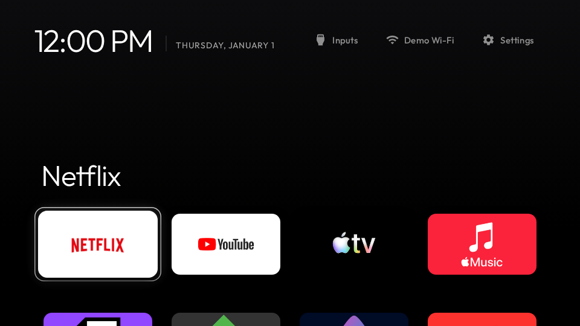

# TV themes

Themes for [Clean Your TV](https://github.com/Razdva122/clean-your-tv-lg-webos) Home on LG webOS.

## Minimal

Pure black, four large cards with no dock band, soft shadows and a quiet header without the greeting.
Header shortcuts stay dim until focused, and grid labels appear only on the focused app.

Install it on the TV from **Settings → Appearance → Theme showcase**, or with **Add by URL** using the
descriptor link under `distributions/minimal/`.

CSS is MIT licensed. See `themes/minimal/CREDITS.txt` for the preview images.
